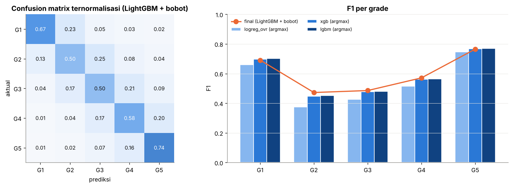
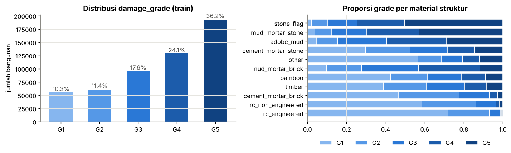
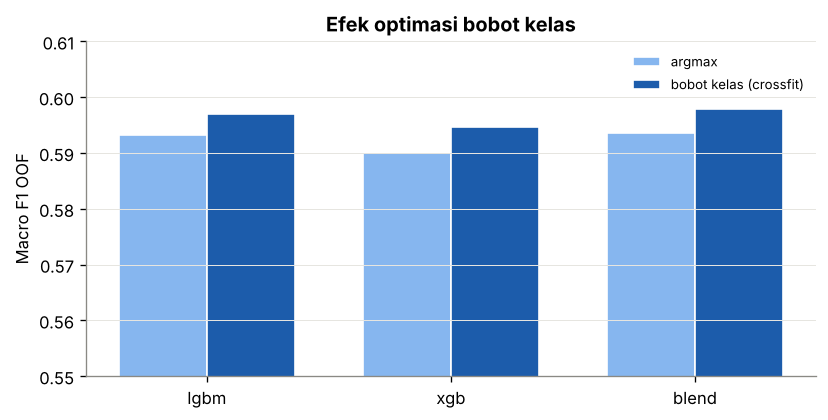

# Structural Damage Classification: Gempa Gorkha, Nepal 2015

Prediksi tingkat kerusakan bangunan (`damage_grade`, Grade 1–5) setelah gempa Gorkha 25 April 2015 (Mw 7,8),
berdasarkan karakteristik struktural bangunan **sebelum** gempa. Tugas 1 Supervised Machine Learning,
lomba Kaggle *structural-damage-classification*, metrik **Macro F1**.

- Model final: **pipeline scikit-learn** (`LocationTargetEncoder` → `ColumnTransformer` → LightGBM berbobot kelas)
- Macro F1 OOF (5-fold, bobot kelas di-*crossfit*): **0.5970**
- Riwayat papan publik: baseline awal 0.55514 → versi 1 notebook **0.5998**
- Tanpa neural network dan tanpa LLM. Semua proses acak memakai `SEED = 42`.

---

## Struktur repository

```
structural-damage-classification/
│
├── README.md
├── .gitignore
├── requirements.txt
│
├── data/                         # dataset Kaggle (tidak di-commit, lihat "Mengunduh data")
│   └── .gitkeep
│
├── notebooks/
│   ├── 01_eda.ipynb              # tahap 1-3: problem statement, cleaning, EDA, cek kebocoran
│   ├── 02_modeling.ipynb         # tahap 4-10: seleksi fitur, ColumnTransformer, Pipeline, CV, evaluasi, optimasi
│   └── 03_submission.ipynb       # prediksi test + validasi format submission
│
├── scripts/
│   ├── __init__.py
│   ├── preprocess.py             # load data, cleaning, fitur tanpa label (BuildingFeatures)
│   ├── feature_engineering.py    # LocationTargetEncoder: fitur berbasis label yang fold-safe
│   ├── train.py                  # ColumnTransformer, Pipeline, CV, bobot kelas, pelatihan final
│   └── predict.py                # memuat pipeline dan menulis submission.csv
│
├── models/
│   └── pipeline_lgbm.pkl         # pipeline final terlatih (joblib)
│
├── submissions/
│   └── submission.csv
│
└── reports/
    ├── metrics.json              # ringkasan metrik dan fitur terpilih
    └── figures/                  # semua figur dari notebook
```

## Cara penggunaan

### 1. Instalasi

```bash
git clone https://github.com/AffrizaWildanFauzan/structural-damage-classification.git
cd structural-damage-classification
python -m venv venv && source venv/bin/activate      # Windows: venv\Scripts\activate
pip install -r requirements.txt
```

### 2. Mengunduh data

Dataset tidak di-commit karena ukurannya besar (`train.csv` ±93 MB, `test.csv` ±38 MB).

1. Buka halaman kompetisi di Kaggle, klik **Join Competition** dan **I Understand and Accept**.
2. Tab **Data** → **Download All**, lalu ekstrak `train.csv`, `test.csv`, `sample_submission.csv` ke folder `data/`.

Atau lewat Kaggle API (setelah menerima aturan kompetisi di web):

```bash
kaggle competitions download -c structural-damage-classification -p data
unzip data/structural-damage-classification.zip -d data
```

### 3a. Menjalankan notebook (disarankan)

Jalankan berurutan dari folder `notebooks/`:

| Notebook | Isi | Waktu (CPU 4 core) |
|---|---|---|
| `01_eda.ipynb` | tahap 1–3, figur EDA ke `reports/figures/` | ±2 menit |
| `02_modeling.ipynb` | tahap 4–10, menyimpan `models/pipeline_lgbm.pkl` dan `reports/metrics.json` | ±57 menit |
| `03_submission.ipynb` | menulis `submissions/submission.csv` | ±2 menit |

`models/pipeline_lgbm.pkl` sudah tersedia, jadi `03_submission.ipynb` bisa langsung dijalankan tanpa melatih ulang.

### 3b. Menjalankan lewat terminal

```bash
python -m scripts.train   --data-dir data --model-out models/pipeline_lgbm.pkl     # CV + latih final
python -m scripts.predict --data-dir data --model models/pipeline_lgbm.pkl --out submissions/submission.csv
```

### 3c. Memakai pipeline di kode sendiri

```python
import joblib
from scripts.preprocess import load_data, add_unsupervised_features

train, test, y = load_data('data')
_, X_test = add_unsupervised_features(train, test)
pipe = joblib.load('models/pipeline_lgbm.pkl')
pred = pipe.predict(X_test)          # grade 1..5
```

## Workflow analisis

| Tahap | Di mana | Ringkasan |
|---|---|---|
| 1. Pemahaman data & problem statement | `01_eda` | klasifikasi multikelas ordinal, Macro F1, struktur `building_id` |
| 2. Data cleaning | `01_eda`, `preprocess.py` | tanpa missing value; umur 999 → flag + cap; rasio per lantai |
| 3. EDA | `01_eda` | distribusi grade, material, lantai, umur, fondasi, lokasi, tetangga ID, cek kebocoran |
| 4. Feature selection | `02_modeling` | gain importance LightGBM, buang gain < 0,1%, diterima kalau tidak turun melebihi derau |
| 5. Normalisasi / transformasi | `02_modeling`, `train.py` | `ColumnTransformer`: passthrough + `OrdinalEncoder` (pohon) atau imputasi + `log1p` + `StandardScaler` + `OneHotEncoder` (linear) |
| 6. Konstruksi model | `02_modeling`, `train.py` | `Pipeline` regresi logistik One-vs-Rest, LightGBM, XGBoost |
| 7. Model selection | `02_modeling` | Macro F1 OOF 5-fold + gerbang derau 2×SE bootstrap |
| 8. Evaluasi | `02_modeling` | classification report, confusion matrix, F1 per grade |
| 9. Visualisasi | `01_eda`, `02_modeling`, `03_submission` | `reports/figures/` |
| 10. Optimalisasi | `02_modeling` | early stopping jumlah pohon, bobot kelas untuk Macro F1, uji ensemble |

### Pipeline

```python
Pipeline([
    ('target_features', LocationTargetEncoder()),   # fitur berbasis label, cross-fitting internal
    ('columns', ColumnTransformer([
        ('num', 'passthrough', <kolom numerik terpilih>),
        ('cat', OrdinalEncoder(...), <kolom kategori terpilih>),
    ])),
    ('model', ClassWeightedClassifier(LGBMClassifier(...), class_weights=[1, 1.5, 1.375, 1.25, 1])),
])
```

`LocationTargetEncoder` bekerja seperti `sklearn.preprocessing.TargetEncoder`: saat `fit_transform`, fitur tiap
baris latih dihitung dari fold lain (label sendiri tidak pernah terlihat); saat `transform`, dipakai statistik dari
seluruh data latih. Karena itu `cross_val_predict(pipeline, ...)` memberi skor validasi yang jujur, dan pipeline yang
sama langsung dipakai untuk test.

## Hasil

Macro F1 out-of-fold (5-fold `StratifiedKFold`, `SEED = 42`):

| Model | Macro F1 (argmax) | Macro F1 (bobot kelas, crossfit) |
|---|---|---|
| Regresi logistik One-vs-Rest* | 0.5443 | – |
| XGBoost | 0.5900 | 0.5946 |
| **LightGBM (final)** | **0.5932** | **0.5970** |
| Blend LightGBM 0.7 + XGBoost 0.3 | 0.5936 | 0.5979 |

\* dievaluasi pada subsampel stratified 150 ribu baris.

Gerbang derau OOF (2×SE bootstrap) = 0.0016. Blend hanya +0.0009 di atas LightGBM, jadi model final tetap LightGBM
tunggal yang lebih sederhana.

F1 per grade model final: G1 0.691 · G2 0.472 · G3 0.486 · G4 0.571 · G5 0.765.



## Laporan interpretasi

**1. Lokasi adalah faktor terkuat, dan `building_id` menyimpan lokasi yang sangat halus.**
Enam digit pertama `building_id` adalah *ward lama* dan sepuluh digit pertama membentuk klaster sekitar 7 bangunan
bertetangga. Bangunan bertetangga dalam urutan ID 2× lebih sering ber-grade sama dibanding pasangan acak (52% vs 24%).
Target encoding per klaster (`te_p10_*`) dan grade tetangga (`nb*`) mendominasi importance. Tanpa fitur lokasi berbasis
label, Macro F1 turun ke ±0.57.

**2. Memisahkan "bangunan lemah" dari "lokasi terguncang keras".**
Fitur terpenting adalah `expected` = `vuln` + `res_p10`:
- `vuln`: rata-rata grade bangunan dengan struktur yang sama di seluruh Nepal (kerentanan struktural);
- `res_p10`: rata-rata residu `grade − vuln` di klaster, yaitu seberapa jauh kerusakan di lokasi itu melebihi kerentanan
  bangunannya (proxy intensitas guncangan lokal).

Dengan begitu model bisa membedakan rumah beton yang rusak berat karena guncangan sangat kuat dari rumah batu-lumpur
yang runtuh di lokasi dengan guncangan sedang.

**3. Material dan konfigurasi struktur.**
Batu dengan mortar lumpur dan adobe paling sering runtuh. Beton bertulang (*engineered*) dan bata-semen paling tahan.
Interaksi material × fondasi × atap (`mat_found_roof`) serta umur bangunan adalah fitur struktural terpenting.



**4. Grade menengah paling sulit.**
Grade 2 (F1 0.47) dan Grade 3 (F1 0.49) terjepit di antara grade tetangga. Confusion matrix menunjukkan kesalahan hampir
selalu ke grade bersebelahan, wajar untuk target ordinal yang dinilai surveyor. Grade 1 (tidak rusak/ringan) dan
Grade 5 (runtuh) paling mudah dikenali.

**5. Bobot kelas menaikkan Macro F1 sekitar +0.004.**
Argmax probabilitas cenderung memilih grade mayoritas (Grade 5, 36%). Bobot `[1, 1.5, 1.375, 1.25, 1]` mendorong
prediksi ke grade 2–4 sehingga recall kelas minoritas naik. Bobot dipilih di OOF dan diukur dengan cross-fitting,
bukan dari papan.



**6. Plafon skor.**
Ribuan bangunan dengan input identik punya grade berbeda (derau penilaian survei), jadi tidak ada model yang bisa
mencapai skor mendekati 1.

## Catatan integritas data

- Data train + test (762.094 bangunan) sama ukurannya dengan data publik *2015 Nepal Earthquake Open Data*. Label test
  kemungkinan bisa dicocokkan dari sumber itu. **Ini sengaja tidak dilakukan.**
- Statistik klaster tanpa label (`cnt_*`, `p10_*`, `p6_*`) dihitung dari train + test, karena tidak memakai target.
- Semua fitur yang memakai target dihitung di dalam fold (cross-fitting).
- Tidak ada neural network maupun LLM di pipeline.
